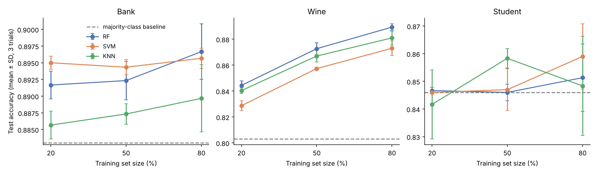

# Comparing Supervised Classifiers Across Datasets
### Random Forest vs. SVM vs. KNN on Three UCI Binary Classification Problems
**COGS 118A — Supervised Machine Learning Algorithms | UC San Diego**

---

## Overview

This project is a small-scale replication of the empirical comparison in
**Caruana & Niculescu-Mizil (2006)**, *"An Empirical Comparison of Supervised Learning
Algorithms."* Three classifiers, **Random Forest**, **SVM (RBF kernel)** and
**k-Nearest Neighbors**, are tuned with cross-validation and compared on three binary
classification datasets from the UCI repository. Each is tested at three training-set
sizes, with three random trials each.

That's **81 experiments** (3 datasets × 3 models × 3 train/test partitions × 3 trials).

---

## Research Question

> *How do Random Forest, SVM, and KNN compare in test accuracy across datasets with
> different sizes, feature types, and class balance, and how does that comparison
> change as the amount of training data grows?*

---

## Key Findings

- **No single best classifier.** Averaged over everything, the three models are within
  half a point of each other (RF 0.870, KNN 0.867, SVM 0.866). The best model depends on the dataset.
- **Random Forest wins on Wine.** It was the most accurate at every training size, reaching
  0.889 with 80% training data. SVM was last on Wine at every size.
- **SVM is strongest on Bank with little data.** SVM led at 20% and 50% training data, and RF
  caught up at 80%. KNN was last on Bank at every size.
- **More data helps most on Wine.** Accuracy rose about 4 to 5 points from 20% to 80%
  training data. On Bank and Student it barely changed.
- **Accuracy alone can mislead on imbalanced data.** On **Student**, every model scores about the
  same as always predicting "pass" (0.846). On **Bank**, models beat "always no" (0.883) by
  only about 1 point. On **Wine**, models beat the baseline (0.803) by 5 to 9 points.



### Mean test accuracy (3 trials)

| Dataset | Train % | RF | SVM | KNN | Majority baseline |
|---|---|---|---|---|---|
| Bank | 20 | 0.892 | **0.895** | 0.886 | 0.883 |
| Bank | 50 | 0.892 | **0.894** | 0.887 | 0.883 |
| Bank | 80 | **0.897** | 0.896 | 0.890 | 0.883 |
| Wine | 20 | **0.844** | 0.829 | 0.840 | 0.803 |
| Wine | 50 | **0.873** | 0.857 | 0.867 | 0.803 |
| Wine | 80 | **0.889** | 0.873 | 0.881 | 0.803 |
| Student | 20 | **0.847** | 0.846 | 0.842 | 0.846 |
| Student | 50 | 0.846 | 0.847 | **0.858** | 0.846 |
| Student | 80 | 0.851 | **0.859** | 0.848 | 0.846 |

Full per-trial results: [`results/test_accuracy_by_trial.csv`](results/test_accuracy_by_trial.csv)

---

## Datasets

| Dataset | Source | Rows | Features | Positive class | Positive rate |
|---|---|---|---|---|---|
| Bank Marketing | UCI #222 | 10,000* | 15 (mixed) | subscribed to term deposit | 11.7% |
| Wine Quality | UCI #186 | 6,497 | 11 (numeric) | quality ≥ 7 | 19.7% |
| Student Performance | UCI #320 | 649 | 30 (mixed) | final grade ≥ 10 (pass) | 84.6% |

\*Stratified subsample of 45,211 rows, to keep SVM and KNN grid searches tractable.
See [`data/README.md`](data/README.md) for preprocessing details, including the leakage-prone
columns that were removed (`duration`, `G1`, `G2`).

---

## Methods

- **Train/test partitions:** 20/80, 50/50 and 80/20, stratified by label.
- **Trials:** 3 random splits per partition, using random seeds 0, 1 and 2.
- **Hyperparameter tuning:** `GridSearchCV` with stratified 5-fold CV on the training set,
  scored by accuracy.
- **Pipelines:** one-hot encoding for categorical features. Numeric features are standardized
  for SVM and KNN. Preprocessing is fit inside each CV fold, so nothing leaks from validation data.

| Model | Hyperparameter grid |
|---|---|
| Random Forest (500 trees) | `max_features` ∈ {1, 2, 4, 6, 8, 10} |
| SVM (RBF kernel) | `C` ∈ {0.01, 0.1, 1, 10, 100}, `gamma` ∈ {0.001, 0.01, 0.1, 1} |
| KNN | `n_neighbors` ∈ {1, 3, 5, 9, 15, 25, 35, 51}, `weights` ∈ {uniform, distance} |

For each run, the notebook records training, cross-validation and test accuracy plus the
best hyperparameters, and saves them to `results.csv`.

---

## Limitations

- **Accuracy only.** On imbalanced datasets (Bank, Student), F1, AUC or balanced
  accuracy would show more clearly whether the models learn anything beyond the
  majority class. The original paper used eight metrics.
- **Three trials** per setting, so differences of a few tenths of a point are within noise.
- **Subsampled Bank data** (10,000 of 45,211 rows) to keep the grid searches fast.

---

## Repository Structure

```
├── 01-ClassifierComparison.ipynb    # Full experiment: load, preprocess, tune, evaluate
├── data/
│   ├── README.md                    # Dataset descriptions and preprocessing
│   ├── 00-raw/                      # Downloaded data (not committed)
│   ├── 01-interim/
│   └── 02-processed/
├── modules/
│   └── get_data.py                  # Downloads the three UCI datasets
├── results/
│   ├── test_accuracy_by_partition.png
│   ├── test_accuracy_by_trial.csv   # All 81 runs
│   └── test_accuracy_summary.csv    # Mean ± SD per dataset/model/partition
├── requirements.txt
└── README.md
```

## How to Run

```bash
git clone https://github.com/khchui05/<repo-name>.git
cd <repo-name>
pip install -r requirements.txt
jupyter notebook 01-ClassifierComparison.ipynb
```

The full grid search (81 runs) takes a while, mostly because of SVM on the Bank dataset.

---

## Stack


- **scikit-learn**: pipelines, `GridSearchCV`, Random Forest, SVM, KNN
- **Pandas / NumPy**: data wrangling
- **ucimlrepo**: dataset loading
- **Matplotlib / Seaborn**: visualization

---

## Author

**Katherine Chui**, COGS 118A, UC San Diego

---

## References

1. Caruana, R., & Niculescu-Mizil, A. (2006). An empirical comparison of supervised learning algorithms. *Proceedings of the 23rd International Conference on Machine Learning (ICML)*, 161–168.
2. Moro, S., Cortez, P., & Rita, P. (2014). A data-driven approach to predict the success of bank telemarketing. *Decision Support Systems*, 62, 22–31. (Bank Marketing)
3. Cortez, P., Cerdeira, A., Almeida, F., Matos, T., & Reis, J. (2009). Modeling wine preferences by data mining from physicochemical properties. *Decision Support Systems*, 47(4), 547–553. (Wine Quality)
4. Cortez, P., & Silva, A. (2008). Using data mining to predict secondary school student performance. *Proceedings of 5th Future Business Technology Conference*. (Student Performance)
5. UCI Machine Learning Repository. https://archive.ics.uci.edu
